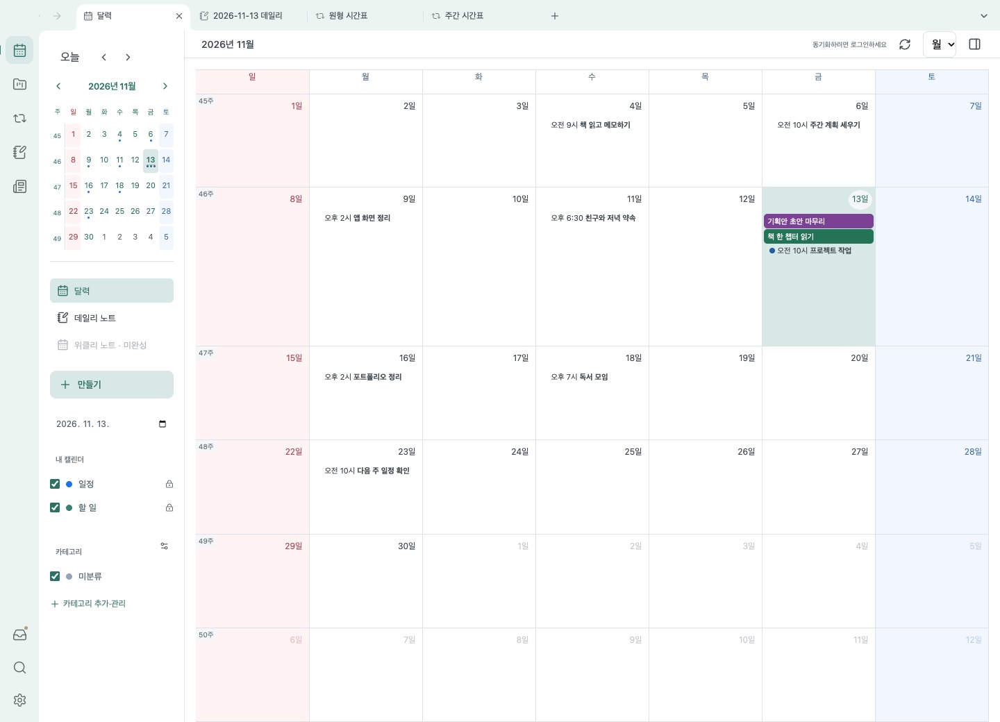
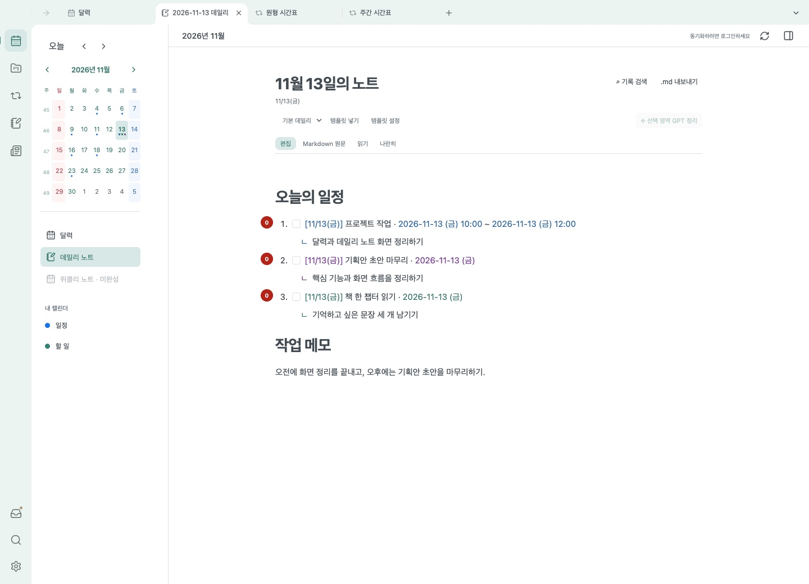
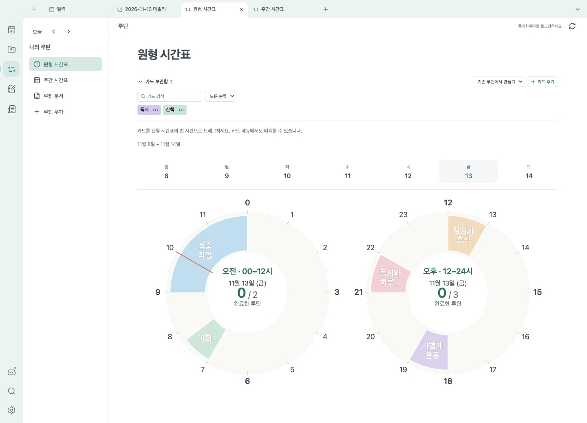
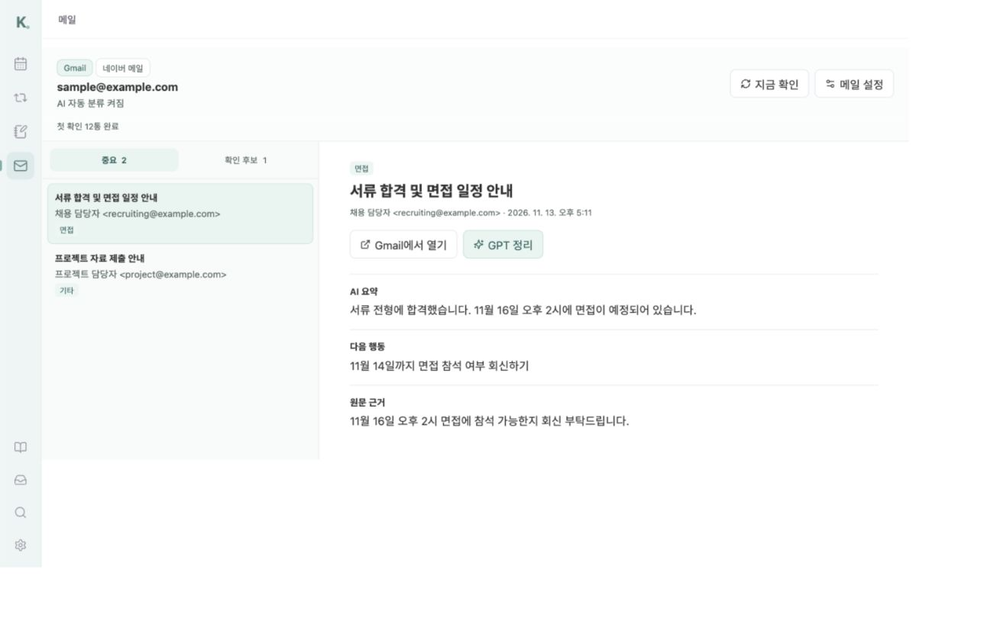

# Kalendar 사용 안내

노트에 적은 약속과 할 일을 GPT로 정리하고, 확인한 내용을 달력에 연결하는 Mac 앱입니다. 반복할 일은 루틴으로 관리하고, 중요한 메일은 목록이나 펫 알림으로 확인할 수 있습니다.

**현재 버전: 0.1.0-beta.3 · Apple Silicon(M1 이상) · macOS 13 이상**

아직 개발 중인 베타 버전입니다. 일부 기능이 불안정할 수 있으므로 중요한 기록은 내보내기로 별도 보관해 주세요. 아래 캡처의 일정·메일·계정은 설명을 위한 예시 데이터입니다.

## 다운로드와 설치

[Mac 베타 설치 파일 다운로드](https://github.com/iamnuked/kalendar-releases/releases/download/v0.1.0-beta.3/Kalendar_0.1.0-beta.3_aarch64.dmg) · [모든 버전 보기](https://github.com/iamnuked/kalendar-releases/releases)

1. Mac의 **이 Mac에 관하여**에서 칩이 Apple M1·M2·M3 등 Apple Silicon인지 확인합니다. Intel Mac용 파일은 아직 없습니다.
2. 다운로드한 `.dmg` 파일을 엽니다.
3. **Kalendar.app**을 **Applications(응용 프로그램)** 폴더로 드래그합니다.
4. 복사가 끝나면 응용 프로그램 폴더의 Kalendar를 실행합니다. DMG 안에서 계속 실행하지 마세요.
5. 서버·Docker 설치나 Kalendar 계정 로그인 없이 사용할 수 있습니다.

### 처음 실행이 차단될 때

현재 버전은 Apple Developer ID 서명과 Apple 공증을 받지 않았습니다. 실행이 차단되면 다음 순서로 해당 앱을 허용할 수 있습니다.

1. 응용 프로그램 폴더의 Kalendar 실행을 한 번 시도합니다.
2. **시스템 설정 → 개인정보 보호 및 보안**을 엽니다.
3. Kalendar에 대한 차단 안내에서 **확인 없이 열기**를 선택하고 화면 안내에 따라 확인합니다.

회사나 학교에서 관리하는 Mac은 이 선택이 제한될 수 있습니다. 시스템 보안 기능 전체를 끄는 작업은 필요하지 않습니다.

## 처음에는 이렇게 사용해 보세요

1. 왼쪽 **데일리 노트**를 열고 날짜를 고릅니다.
2. `금요일 오전 10시에 프로젝트 작업. 오늘까지 기획안 마무리.`처럼 적습니다.
3. GPT를 쓰려면 먼저 **설정 → OpenAI**에서 본인 API 키를 저장합니다.
4. 노트에서 정리할 본문을 선택하고 **선택 영역 GPT 정리**를 누릅니다.
5. 제안된 내용과 날짜를 확인한 뒤 **확인한 내용 적용**을 누릅니다.
6. **달력**에서 연결된 약속과 할 일을 확인합니다.

글을 쓰는 즉시 달력이 변경되는 것은 아닙니다. **GPT 정리 → 미리보기 확인 → 적용**을 거쳐 연결됩니다. GPT 없이도 일정과 노트를 직접 작성할 수 있습니다.

## 1. 달력에서 일정과 할 일 관리하기

- 왼쪽 **달력**을 누릅니다. 상단에서 **일·주·월** 보기를 바꿀 수 있습니다.
- **오늘**, 이전·다음 버튼으로 날짜를 이동합니다.
- **만들기**에서 일정이나 할 일을 추가합니다. 일정에는 시작·종료 시각을, 할 일에는 필요한 경우 마감일을 입력합니다.
- 달력에 있는 항목을 누르면 내용을 확인하고 수정할 수 있습니다.
- 왼쪽 필터에서 일정·할 일 또는 카테고리별 표시 여부를 바꿀 수 있습니다.
- 노트에서 연결한 항목은 노트의 항목 색상과 맞춰 표시됩니다. 별도의 카테고리 색상을 지정했다면 카테고리 색상이 우선할 수 있습니다.

## 2. 데일리 노트와 달력 연결하기

위 화면의 **프로젝트 작업**, **기획안 초안 마무리**, **책 한 챕터 읽기**는 달력 화면에도 같은 항목으로 나타납니다. 노트의 날짜 색상과 달력의 항목 색상을 비교해 보세요.

### 노트 작성

1. **데일리 노트**를 열고 왼쪽 작은 달력에서 기록할 날짜를 선택합니다.
2. 본문에 일정, 할 일, 메모를 적습니다. 작성 내용은 이 기기에 자동 저장됩니다.
3. 제목·번호 목록·체크박스·표 등을 사용해 내용을 나눌 수 있습니다. **Markdown 원문**이나 **읽기** 보기로도 확인할 수 있습니다.
4. 자주 쓰는 양식은 **템플릿 설정**에서 만들고 **템플릿 넣기**로 삽입합니다.

### GPT로 일정과 할 일 추출

1. 정리할 본문을 드래그하거나 항목 선택 기능으로 선택합니다.
2. **선택 영역 GPT 정리**를 누릅니다. 선택하지 않은 상태에서는 버튼을 사용할 수 없습니다.
3. 미리보기에서 정리된 본문, 새로 연결할 항목, 날짜 변경 내용을 확인합니다.
4. 날짜나 대상이 모호하면 질문이 표시됩니다. 본문에 정확한 날짜·시간을 보충한 뒤 다시 정리합니다.
5. **확인한 내용 적용**을 누르면 확인한 내용이 노트와 달력에 반영됩니다. **취소**하면 미리보기의 변경은 반영하지 않습니다.

GPT가 해석한 날짜와 완료 여부는 직접 확인해 주세요. GPT 결과를 검증하지 않고 자동 등록하는 방식은 아닙니다.

### 연결된 날짜 직접 바꾸기

노트에 표시된 **예정·마감 날짜**를 바꾸면 달력 반영 미리보기를 확인할 수 있습니다. **확인한 날짜를 달력에 적용**을 눌러야 실제 일정이 변경됩니다. 반복 일정이나 모호한 날짜는 일정 편집 화면에서 확인이 필요할 수 있습니다.

### 주간 기록과 내보내기

- 상단 **주간**에서 일주일의 기록을 확인하고 편집합니다. 한 주는 일요일부터 토요일입니다.
- 주간 GPT 요약으로 초안을 만들 수 있습니다. 요약 후에도 직접 확인하고 수정합니다.
- **주간 노트 확정**으로 저장한 기록은 이후의 일일 기록 변경으로 덮어쓰지 않습니다. 정정할 때는 사유와 새 버전을 남깁니다.
- **.md 내보내기**로 현재 기록을 Markdown 파일로 저장할 수 있습니다.

## 3. OpenAI API 키 설정하기

OpenAI API 키를 앱에 저장하면 노트 정리와 메일 요약을 사용할 수 있습니다. 사용 요금은 본인의 OpenAI API 계정에 청구됩니다.

1. 왼쪽 **설정 → OpenAI**를 엽니다.
2. 본인의 **OpenAI API 키**를 입력합니다. 채팅이나 공개 문서에 키를 올리지 마세요.
3. **모델 ID**는 본인 API 계정에서 사용할 수 있고 구조화된 출력을 지원하는 모델로 지정합니다. 기본값이 계정에서 지원되지 않으면 변경합니다.
4. **Keychain에 저장**을 누릅니다.
5. 노트로 돌아가 GPT 정리를 사용합니다. 저장만으로 실제 API 호출이나 요금이 발생하지는 않습니다.

저장한 키는 Mac의 Keychain에 보관되며 화면에 다시 표시하지 않습니다. 키나 모델을 바꾸려면 새 키와 모델을 함께 입력합니다. **키 삭제**를 누르면 저장된 키를 제거할 수 있습니다. 삭제 전에 시작된 요청은 완료될 수 있습니다.

GPT 사용에는 인터넷 연결이 필요합니다. 정리할 본문·관련 기록 또는 메일 내용이 OpenAI로 전송됩니다. ChatGPT 구독과 OpenAI API 계정의 이용·요금은 별개입니다.

## 4. 반복할 일은 루틴으로 관리하기

1. 왼쪽 **루틴**을 누릅니다.
2. **루틴 추가**에서 이름, 시간과 반복할 요일을 지정합니다.
3. **원형** 보기에서 하루의 흐름을, **주간** 보기에서 요일별 계획을 확인합니다.
4. 완료한 루틴은 체크하고, 하지 않을 회차는 **건너뛰기**로 처리합니다.
5. 이미 만든 루틴을 눌러 수정합니다. 변경 범위에 따라 해당 회차 또는 이후 계획을 확인해 적용합니다.

**루틴 문서**에서 계획을 글과 표로 정리할 수도 있습니다. 문서 수정은 자동 저장되지만 반복 시간표는 **시간표에 적용**을 눌러야 바뀝니다.

## 5. 중요 메일 확인과 GPT 요약

메일 서비스 연결은 별도로 필요합니다. 예시 화면처럼 중요 메일과 확인 후보를 나눠 보고, 선택한 메일의 요약·다음 행동을 확인할 수 있습니다.

### Gmail 연결

1. Google Cloud에서 Gmail API를 사용 설정합니다.
2. OAuth 동의 화면을 구성합니다. 테스트 상태라면 연결할 본인 Google 계정을 테스트 사용자에 추가합니다.
3. OAuth 클라이언트 유형을 **데스크톱 앱**으로 만들고 JSON 파일을 다운로드합니다.
4. Kalendar의 **설정 → Gmail**에서 **Google 데스크톱 OAuth JSON** 파일을 선택합니다.
5. 열린 브라우저에서 연결할 Google 계정을 승인합니다. 연결 후 메일 화면으로 이동합니다.

Gmail 연결에는 이 준비가 필요하며, API 키만 입력한다고 Gmail까지 연결되는 것은 아닙니다.

### 네이버 메일 연결

1. 네이버 메일 설정에서 **IMAP 사용**을 켭니다.
2. 네이버ID 보안 설정에서 **앱 비밀번호**를 발급받습니다.
3. Kalendar의 **설정 → 네이버 메일**에서 메일 주소와 앱 비밀번호를 입력합니다.
4. **네이버 메일 연결**을 누릅니다. 일반 로그인 비밀번호 대신 앱 비밀번호를 사용합니다.

### 중요한 메일과 새 알림 확인

- 왼쪽 **메일**에서 **Gmail·네이버 메일**을 전환합니다.
- **지금 확인**으로 메일을 새로 확인합니다. 앱이 실행 중일 때 새 메일을 주기적으로 확인합니다.
- **메일 설정**에서 발신자·제목 규칙을 설정할 수 있습니다.
- 개인 OpenAI API 키를 설정하고 **AI 자동 분류 켜기**를 선택하면 최근 메일부터 분류합니다. 초기 분류에는 시간이 걸릴 수 있습니다.
- **중요**와 **확인 후보**를 확인하세요. AI 분류가 중요한 메일을 놓칠 수 있으므로 원래 받은편지함도 확인해 주세요.
- 새 중요 메일을 펫으로 받으려면 아래의 펫 설정도 완료해야 합니다.

### 메일에서 일정·할 일로 이어가기

1. 메일을 선택하고 **GPT 정리**를 누릅니다. 펫의 같은 버튼에서도 시작할 수 있습니다.
2. 본문 전송 안내를 확인하고 **GPT로 정리**를 누릅니다.
3. 요약과 제안된 일정·할 일의 제목, 날짜를 확인합니다.
4. 등록할 항목을 선택한 뒤 **선택한 항목 등록**을 누릅니다.
5. 등록한 항목은 달력과 오늘의 데일리 노트에서 확인할 수 있습니다. 제안만 보는 동안에는 등록되지 않습니다.

## 6. 펫으로 알림 받기

위 화면은 예시 메일을 알리는 펫입니다. 펫은 일정·루틴·중요 메일을 안내하며, 메일의 **GPT 정리** 버튼으로 요약 화면을 열 수 있습니다. 자유 대화형 GPT 채팅 기능은 아닙니다.

1. **설정 → 펫 → 펫 파일 가져오기**를 누릅니다.
2. 사용할 펫의 **pet.json과 연결된 PNG·WebP 이미지 파일을 함께** 선택합니다. 펫 파일은 별도로 준비해야 하며 위 캐릭터가 설치 파일에 기본 포함되는 것은 아닙니다.
3. 미리보기를 확인하고 **등록하고 표시**를 누릅니다.
4. **펫 표시**를 켭니다. 필요한 경우 알림음, 볼륨, 조용한 시간을 조정합니다.
5. 펫을 드래그해 위치를 옮기고, 펫을 눌러 현재·다음 항목을 확인합니다.

- **자세히 볼래**: 연결된 항목을 엽니다.
- **다 했어 ✓**: 할 일이나 루틴을 완료합니다.
- **10분 뒤 알려줘**: 원래 일정 시간을 바꾸지 않고 다시 알림을 설정합니다.
- 메일의 **GPT 정리**: 해당 메일의 요약 화면으로 이동합니다.
- **잠깐 쉬고 있어**: 펫을 잠시 숨깁니다.

앱을 최소화해도 펫은 표시될 수 있지만, 메인 창을 닫으면 함께 숨깁니다. 앱을 완전히 종료하면 펫과 새 메일 확인은 작동하지 않습니다. 조용한 시간에는 자동 말풍선과 알림음이 멈춥니다. 펫의 기본 일정 안내에는 OpenAI 키가 필요하지 않으며, GPT 메일 요약에는 키가 필요합니다.

## 7. 필기 노트·검색·알림

- **필기 노트**: 날짜와 관계없는 문서를 작성하고 폴더·태그로 정리합니다. 문서별 또는 전체 Markdown 내보내기를 사용할 수 있습니다.
- **검색 또는 ⌘K**: 노트·일정·할 일을 검색합니다. 검색 결과에서 노트나 달력의 해당 위치로 이동할 수 있습니다.
- **설정 → 알림**: Mac 알림 권한과 예약 상태를 확인합니다. 알림이 차단되었다면 macOS 시스템 설정에서 Kalendar 알림을 허용합니다.
- **정리함**: 지난 일정과 마감 지난 할 일을 모아 확인하고 완료·날짜 변경·보류 등으로 정리합니다.

## 업데이트와 데이터 보관

- **설정 → 일반 → 앱 업데이트 → 업데이트 확인**에서 새 버전을 확인합니다. 앱 시작 시에도 업데이트를 확인합니다.
- 새 버전이 있으면 안내를 읽고 설치 여부를 선택합니다. 재시작 전에는 작성 중인 내용을 저장해 주세요.
- 자동 업데이트에 실패하면 [릴리스 목록](https://github.com/iamnuked/kalendar-releases/releases)에서 DMG를 받아 다시 설치할 수 있습니다.
- 업데이트 파일은 별도 서명을 검증합니다. Apple 공증을 의미하지 않으며, 업데이트 뒤 macOS 실행 확인이나 Keychain 승인을 다시 요청할 수 있습니다.
- 일정과 노트는 이 Mac에 저장됩니다. 현재 베타의 서버 로그인·기기 간 동기화·서버 DB 백업은 제공하지 않습니다.
- 앱을 업데이트할 때 같은 앱 식별자와 저장소를 사용하지만, 다른 Mac에서의 실제 구버전 업데이트·데이터 유지 검증은 아직 완료되지 않았습니다. 업데이트 전에 중요한 기록을 내보내세요.
- **.md 내보내기**와 필기 노트 내보내기는 문서 보관용이며, 앱의 모든 설정·루틴·연결 정보를 완전히 복원하는 전체 백업과는 다릅니다.

## 베타 버전에서 확인 중인 부분

다른 Mac에서의 설치·업데이트, Siri·단축어와 공개 환경의 장기 사용은 아직 충분히 검증되지 않았습니다. 기능 개선과 함께 설치 파일을 계속 갱신할 예정입니다.
